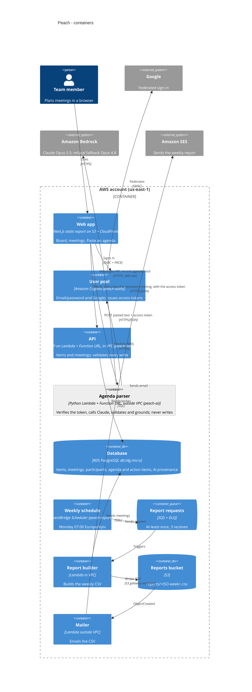

# C4 level 2: containers

Peach after Lab 6. The grey container (`peach-ai`) is not deployed yet.

**What changed in Lab 6:**
- New container: the **Agenda parser**, outside the VPC. Its only outbound calls are to
  Bedrock and the Cognito JWKS.
- New relationship: the web app calls the parser **only** for suggestions, then saves through
  the **API** as before.
- The API now checks the same Cognito access token on every meetings endpoint. It has no
  arrow to Cognito because it never calls it: the signing keys are pinned at deploy time,
  since the API Lambda in the VPC has no internet access.
- The database stores the original suggestion, model and prompt version beside the saved
  meeting.

The parser has no relationship to the database. That absence is deliberate, and a test checks
it (`test_parser_handler.py`). See [ADR 0006](../adr/0006-llm-agenda-parsing.md).
